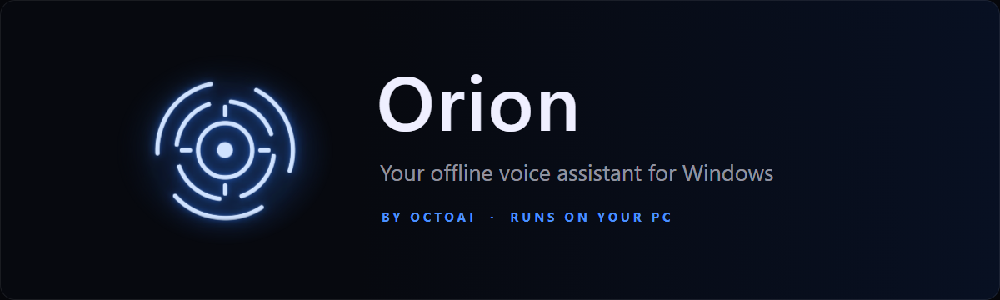

<p align="center">
  
</p>

<p align="center">
  <a href="https://github.com/Khan-Doruk/orion-releases/releases/latest"></a>
  <a href="https://github.com/Khan-Doruk/orion-releases/releases"></a>
  
  
</p>

<p align="center">
  <a href="https://github.com/Khan-Doruk/orion-releases/releases/latest/download/OrionSetup.exe"><b>Download Orion for Windows</b></a>
  &nbsp;·&nbsp;
  <a href="https://github.com/Khan-Doruk/orion-releases/releases">Release notes</a>
  &nbsp;·&nbsp;
  <a href="https://ai.octoman.io">ai.octoman.io</a>
</p>

---

Orion is a voice assistant that lives on your PC. Say **"Hey Orion"** or click the mic, and he opens apps, sets timers and reminders, plans your day around your calendar, keeps track of your projects and answers questions. The AI model runs on your own machine through [Ollama](https://ollama.com), so your conversations stay with you.

## What Orion does

| | |
|---|---|
| **Talk naturally** | You don't need exact commands. "It's way too loud in here" turns the volume down, "ping me in 15 minutes to stretch" sets a reminder. A small line shows which command ran. |
| **Your day at a glance** | The TODAY panel picks up to three things for today, shows what's due this week and which projects went quiet. Before noon you get a short spoken morning briefing. |
| **Projects** | Keep notes, files, links and assignments per project. Ask about a project and Orion answers from its notes, files and recent commits. |
| **Calendar and planning** | Connect Google Calendar to see and add events. "Find 2 hours for the report this week" suggests free slots and books them only when you say yes. |
| **Memory** | Orion remembers lasting things you tell him and what you talked about on earlier days. Passwords and account numbers are never kept. See and delete everything in Settings. |
| **Your phone** | Get notifications on your phone, or send Orion commands from it. Anything risky asks first, with Yes and No buttons. |
| **Gentle nudges** | At most twice a day, a reminder about what's overdue or untouched. Say "not now" to snooze. |
| **Weekly review** | On Sunday evening: what you finished, what slipped, and what to focus on next week. |

### Try saying

```text
Hey Orion, what's on today?
Open Chrome
Set a timer for 25 minutes
Remind me in 20 minutes to check the build
Find 2 hours for the report this week
What do you remember?
Plan my day
```

## Getting started

1. **Download** [`OrionSetup.exe`](https://github.com/Khan-Doruk/orion-releases/releases/latest/download/OrionSetup.exe) and run it. No administrator rights needed.
2. If Windows shows **"Windows protected your PC"**, click **More info**, then **Run anyway**. The installer isn't code-signed yet.
3. Setup installs **Ollama**, the local AI engine, if it's missing or out of date (about 1.6 GB).
4. On first start, enter your **product key**. Orion is in testing with a small group, and keys are handed out to testers.
5. Pick the **AI model** on the welcome screen. Orion recommends one for your graphics card, and it downloads once.

## Requirements

| | |
|---|---|
| **System** | Windows 10 or 11, 64-bit |
| **Graphics card** | An NVIDIA card with 8 GB of memory gives the best answers and the fastest hearing. Smaller cards, and PCs without one, get a smaller model and run slower. |
| **Disk space** | About 12 GB with the largest model (Orion, Ollama and the model together) |
| **Microphone** | Optional. You can type everything too. |
| **Internet** | For setup and the model download. After that the AI works offline; weather, news, calendar and phone features need a connection. |

**Which model you get**

| Graphics memory | Model | Download |
|---|---|---|
| 8 GB or more | qwen3.5:9b | about 6.6 GB |
| 4 to 8 GB | qwen3.5:4b | about 3.3 GB |
| Less, or no NVIDIA card | qwen3.5:2b | about 2.7 GB |

You can switch any time in **Settings, AI model**.

## Privacy

- **The AI runs on your PC.** Questions and replies are handled by the model on your machine, not by a cloud service.
- **Your voice stays local.** Speech is turned into text on your PC; no recordings are uploaded.
- **Online only for what you use.** Weather (Open-Meteo), news headlines in the briefing, Google Calendar if you connect it, phone notifications if you link your phone, and the update check on this page.
- **Secrets are encrypted.** Your calendar sign-in and phone links are stored with Windows encryption, readable only by your Windows account on that PC.
- **You're in control of memory.** Everything Orion remembers is listed in Settings, with a forget button for each item.

## Updates

Orion checks this page for new versions and shows a bar with **Install**, **What's new** and **Later**. Every update is checked against a signed list of file hashes before it installs, and it keeps your data, activation and AI model. Say **"beta updates on"** to also get pre-releases.

### Check your download

Each release includes `SHA256SUMS.txt`. In PowerShell, in the folder you downloaded to:

```powershell
Get-FileHash .\OrionSetup.exe -Algorithm SHA256
```

The hash should match the line for `OrionSetup.exe` in `SHA256SUMS.txt`.

## Help

- **Something not working?** Open **Settings, About, CHECK MY SETUP**. It tests the voice, hearing, wake word, AI and microphone in one go. **COPY REPORT** gives you a text to send along; it contains no personal data.
- **Shortcuts:** `Ctrl+Shift+O` shows or hides Orion, `Ctrl+Shift+C` copies his last reply.
- **Language:** Orion understands and speaks English.
- **Uninstalling:** Windows Settings, Apps, Orion. This removes Orion and his data, then asks whether to remove **Ollama and its AI models** too. If Orion installed Ollama, Yes is preselected; if you had Ollama already, No is, so other apps that use it keep working. Versions up to 1.19.0 remove Ollama and its models without asking, so update Orion before uninstalling.

---

<p align="center">
  This repository holds Orion's installers and release notes only.<br>
  Orion is made by <a href="https://ai.octoman.io">OctoAI</a>, the AI division of <a href="https://octoman.io">Octoman</a>.
</p>
